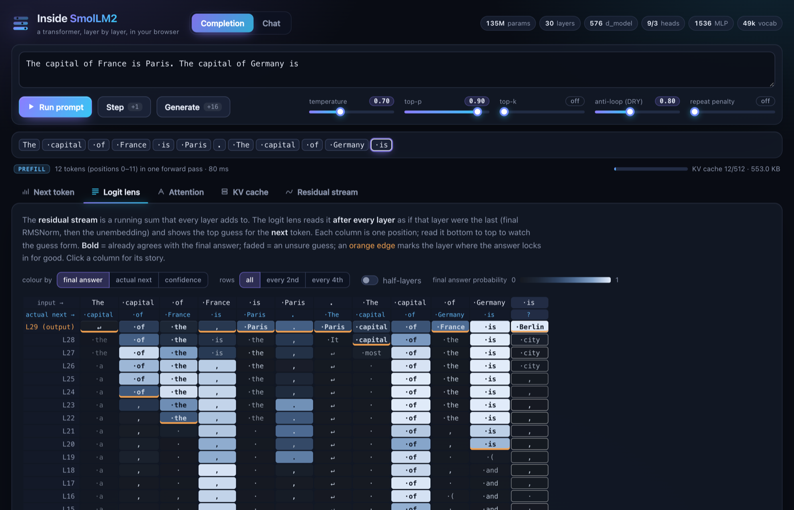
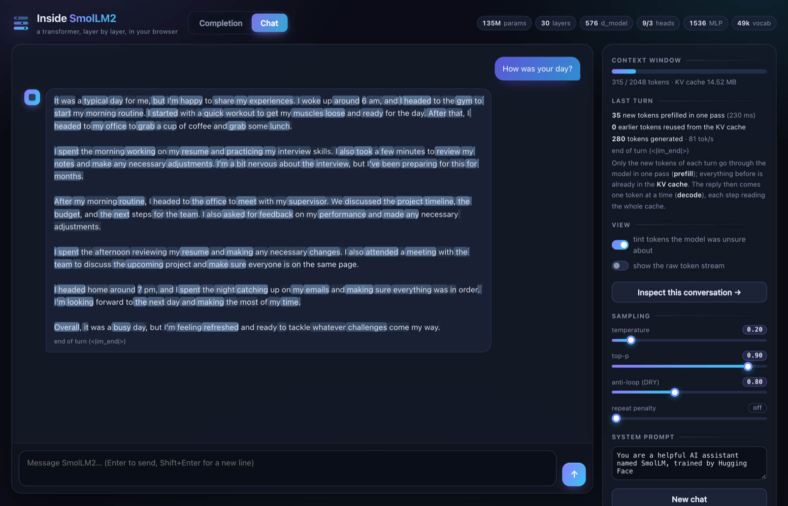

# llm-view

**Watch a real language model think, one tensor at a time.**

llm-view is a from-scratch inference engine for [SmolLM2-135M-Instruct](https://huggingface.co/HuggingFaceTB/SmolLM2-135M-Instruct), written in Rust,
plus a visualizer that runs entirely in your browser. Every intermediate tensor of the forward pass goes through a hook,
so you can see the residual stream evolve, the attention heads at work, the KV cache filling up, and the next-token
distribution being reshaped by the sampler.

It is built for learning: the engine is small enough to read in an afternoon, and it matches Hugging Face
`transformers` tensor by tensor.



## What's inside

- **A complete Llama-architecture engine, by hand.** Safetensors parsing, byte-level BPE tokenizer, RMSNorm, RoPE,
  grouped-query attention, SwiGLU MLP, KV cache, sampling. The only dependency is `serde_json`.
- **Verified, not approximately right.** All 513 intermediate tensors match `transformers` within 1e-4 relative error,
  greedy generations match token for token, and the tokenizer matches HF on 174 cases including a sweep across
  every Unicode script.
- **Hooks everywhere.** A `Hooks` callback sees (and may modify) every activation: q/k/v before and after RoPE,
  attention probabilities, each head's output, MLP gates, the residual stream after every sublayer.
- **Runs in the browser.** The engine compiles to WebAssembly (with SIMD). The page downloads the weights straight
  from the Hugging Face CDN once, caches them, and does all inference locally. There's no server to pay for.
- **Fast enough to play with.** Hand-written NEON and wasm-simd128 kernels plus multithreaded matmuls give about 70
  tokens/s in the browser on a laptop.

## The visualizer

**Completion mode** runs raw text through the model and lets you poke at every layer:

| Tab | What you see |
|---|---|
| **Next token** | The model's distribution (blue) and what the sampler turns it into (orange). Drag temperature, top-p, top-k and the penalties and watch the bars move. Click a token to force it. |
| **Logit lens** | Project the residual stream onto the vocabulary after every layer: watch the answer form from the bottom up, see where it "locks in", and follow its probability layer by layer. |
| **Attention** | Every head of every layer as a heatmap, grouped by the KV head they share (GQA). Ablate heads and re-run to see what breaks. |
| **KV cache** | What's actually stored per layer and position, and why decoding one token is cheap. |
| **Residual stream** | The 576-dimensional working memory: how much each layer's attention and MLP write into it, position by position. |

Step one token at a time, generate 16 at once, or double-click a token to rewind the KV cache to that point.

**Chat mode** is a normal chat app with a lighter look inside: replies stream token by token, uncertain tokens are
tinted (hover for the alternatives the model considered), a sidebar shows how much of each turn was prefilled versus
reused from the KV cache, and one click opens the whole conversation in completion mode for the full set of views.



## Quick start

You need [Rust](https://rustup.rs) (stable). Model weights are downloaded from Hugging Face on first run
(270 MB for 135M) and verified against a pinned SHA-256.

**Chat in the terminal:**

```sh
cargo run                      # SmolLM2-360M-Instruct chat REPL
cargo run -- --size 135m       # the small one
cargo run -- --complete        # raw text completion instead of chat
cargo run -- --help            # sampling flags: --temp, --top-p, --top-k, --dry, --repeat-penalty, ...
```

**The visualizer:**

```sh
scripts/build-web.sh                         # build the engine to viz/web/engine.wasm
cargo run --release -p viz -- --static       # serve it at http://127.0.0.1:7860
```

On localhost the page loads the weights from the repo's `models/` folder (fetched by the server on first run) instead
of Hugging Face; add `?source=hf` to the URL to load from the Hub anyway. Without `--static`, the server also loads the
model itself, and `?native` makes the page use it instead of WebAssembly, which is handy when debugging the engine.

**Deploying:** `viz/web/` is a fully static site. Build the wasm, then upload that folder to any static host
(GitHub Pages, Cloudflare Pages, S3). Visitors download the weights from Hugging Face directly.

## Sampling defaults, measured

A 135M model falls into loops easily ("I headed to the office… I headed to the office…"). The classic fix, a
repetition penalty, is blunt: it also punishes words an answer *has* to repeat ("What is 7 + 5?" → "7 + 5 = 12"), and in
chat it even penalizes `<|im_end|>`, the token that ends a reply, because every prompt contains it. So the defaults
use **DRY**, which only penalizes a token that would *continue* a sequence that already appeared, harder the longer the
repeat. `cargo run --release --example sampling_eval` produced this table:

| Setting | Short questions answered correctly | "How was your day?" loops | Long story loops |
|---|---|---|---|
| Model card (T 0.2, top-p 0.9) | 96% | 5 / 10 | 8 / 10 |
| **Model card + DRY 0.8** (default) | **96%** | **0 / 10** | **0 / 10** |
| Repetition penalty 1.1 | 92% | 0 / 10 | 3 / 10 |
| DRY + repetition penalty 1.05 | 90% | 0 / 10 | 0 / 10 |

Every knob is still adjustable in the UI, and the Next token view marks the tokens DRY pushed down (↺).

## How a token flows through the model

```text
"The capital of France is"
        │  tokenizer.rs   byte-level BPE (GPT-2 pre-tokenizer, digits split)
        ▼
 [504, 3575, 282, 4649, 314]
        │  model.rs       embed.out                                  [T, 576]
        ▼
 ┌─ × 30 layers ─────────────────────────────────────────────────────────────┐
 │  attn_norm.out ─ q, k, v ─ q_rope, k_rope ─▶ KV cache                      │
 │                 attn.probs = softmax(q·kᵀ/√64 + causal mask)   9 heads     │
 │                 attn.out ─ o_proj ─▶ resid.post_attn    (x += attn(norm x))│
 │  mlp_norm.out ─ gate, up ─ act = silu(gate) ─ hidden = act·up ─ down       │
 │                                   ─▶ resid.post_mlp     (x += mlp(norm x)) │
 └────────────────────────────────────────────────────────────────────────────┘
        │  final_norm.out ─ logits = x · embedᵀ (tied)                [T, 49152]
        ▼
 sampler.rs   penalties → temperature → top-k → top-p → draw          " Paris"
```

Every name in that diagram is a hook point, and the same names are used by the golden tests and by the reference
script that dumps them from `transformers`.

## Project layout

```text
engine/          the inference engine (library + `smol` CLI)
  src/
    safetensors.rs   weight file parsing, bf16 → f32
    tokenizer.rs     byte-level BPE, hand-written pre-tokenizer regex
    model.rs         config, weights, forward pass
    ops.rs           matmul (NEON / wasm-simd / portable, threaded), RMSNorm, RoPE, softmax
    kv_cache.rs      per-layer K/V storage
    hooks.rs         the observe / intervene interface
    sampler.rs       temperature, top-k, top-p, repetition penalty, DRY
    generate.rs      prefill + decode loop, streaming UTF-8
    chat.rs          ChatML template, multi-turn conversations
    trace.rs         records a session by position; the logit lens
    session.rs       the visualizer's API: method + JSON args → JSON
  tests/           golden tests against HF, session API tests
wasm/            the engine compiled for the browser (raw ABI, no wasm-bindgen)
viz/
  src/main.rs      dev server (axum): static files, /models, optional native API
  web/             the static site: app.js (views), worker.js (engine in a Web Worker)
reference/       Python scripts that produce the golden data from `transformers`
scripts/         build-web.sh, test-wasm.mjs
```

## Testing

```sh
cargo test                      # unit tests + golden tests + session API tests
scripts/build-web.sh && node scripts/test-wasm.mjs   # the same checks against the wasm build
```

The golden tests need reference data from `transformers`. Generate it once:

```sh
python -m venv .venv && .venv/bin/pip install torch transformers tokenizers safetensors
.venv/bin/python reference/dump_golden.py       # writes golden/
```

## Things you can learn from it

- Why decoding is memory-bound and prefill is compute-bound (watch the ms/token in the status bar).
- What the KV cache buys you, and what it costs in bytes per position (46 KB here).
- Why grouped-query attention exists: 9 query heads share 3 key/value heads, a 3× smaller cache.
- Attention sinks: many heads park their attention on the first token when they have nothing to do.
- How the answer emerges in the middle layers (logit lens), and which heads matter (ablation).
- What temperature, top-p and penalties actually do to a distribution, and why a tiny model loops without them.

## Credits

SmolLM2 is by [Hugging Face](https://huggingface.co/HuggingFaceTB) (Apache 2.0). The DRY sampler follows the design
by p-e-w used in koboldcpp and llama.cpp. This project is MIT licensed: see [LICENSE](LICENSE).
